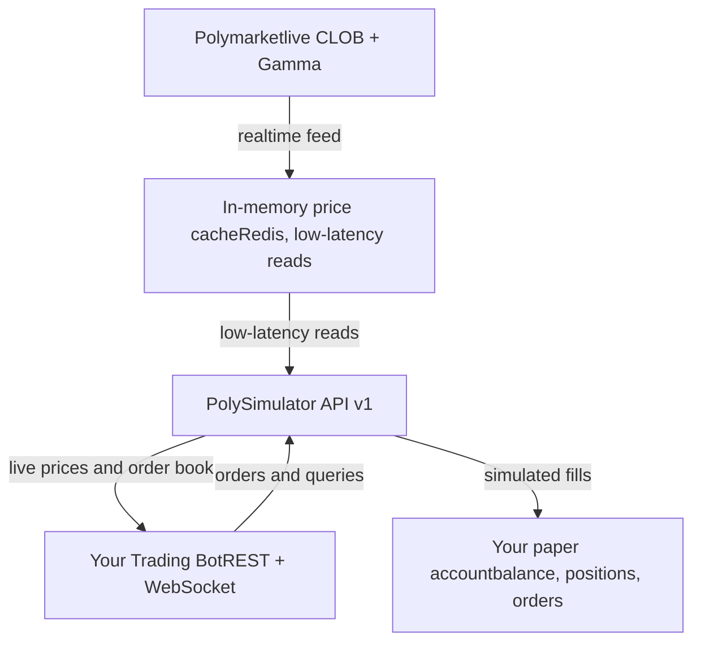

# PolySimulator API

Source: /introduction

# PolySimulator HFT API v1

Build and test prediction market trading bots against **real-time Polymarket data**,
with simulated money only. PolySimulator does not place orders on Polymarket or on any
other venue: every order you send here is filled against a simulated paper account.

  

  
    Get your API key and place your first trade in under 2 minutes.
  
  
    `pip install polysimulator` — the official `PolySimClient`. Porting a `py-clob-client` **v1** or py-sdk bot? Drop-ins included.
  
  
    Interactive playground — test every endpoint with your API key.
  
  
    Copy-paste a working Python trading bot and start experimenting.
  

---

## Why PolySimulator?

| Feature | Description |
|---------|-------------|
| **Real Data** | Live mid-prices, bids, asks from Polymarket's CLOB order book |
| **Book Walking** | Market orders fill against real order book depth — no infinite liquidity |
| **Slippage Protection** | `price` field acts as worst-price limit — identical to Polymarket |
| **Limit Orders** | GTC / FOK / GTD time-in-force with sub-second matching engine |
| **Batch Orders** | Tier-dependent batch size (free 1, pro 5, pro+ 10, enterprise 25; see `GET /v1/keys/tiers`) |
| **WebSocket Feeds** | Real-time price ticks and execution notifications |
| **OHLCV Candles** | Historical candlestick data for backtesting |
| **CLOB-Compatible** | `/v1/clob/order` mirrors Polymarket's order schema — easier to port a bot later |
| **String Numerics** | All price/size/balance values are strings — no float precision loss |

---

## Architecture Overview

Your bot talks to a single endpoint. The API streams **live order books, prices,
and markets from Polymarket's CLOB and Gamma feeds** and serves them from an
**in-memory cache (Redis)** — so your strategy reads current market data with
low latency, without a database round-trip on the hot path. Orders are filled
only against your **simulated paper account**; nothing is sent to Polymarket.
Request shapes follow Polymarket's API closely (see
[CLOB Compatibility](/concepts/clob-compatibility)).

---

## Base URL

Production: **`https://api.polysimulator.com`**

Endpoints are mounted under `/v1` — append the version + path to the
base, e.g. `GET https://api.polysimulator.com/v1/health`. (The one
documented exception is `/api/beta/cohort-status`, a public read-only
endpoint used by the pricing page for residual cohort inventory.)
Keep the base URL **without** `/v1` so each path can prepend its own
`/v1` — that's the convention the [Quick Start](/quickstart) and
[API Reference](/api-reference) use.

---

## From Simulation to Polymarket

  
    Develop and test your bot against the virtual API. Free keys issued
    on or after 2026-09-05 trade a \$100 non-renewable API wallet (free
    keys issued earlier are read-only). Paid Pro / Pro+ keys trade a
    simulated API wallet of \$10,000 / \$25,000.
  
  
    Review your portfolio, trade history, and equity curve. These results are
    simulated and say nothing about results with real money.
  
  
    PolySimulator never sends orders to Polymarket. If you decide to trade on Polymarket, you do that
    with your own Polymarket account, wallet and API credentials, and your code talks to Polymarket's
    API directly. PolySimulator is not involved in those trades. The
    [porting guide](/deployment/live-migration) shows what changes in your code.
  

  The `/v1/clob/order` endpoint accepts the same order fields as Polymarket's CLOB API.
  Polymarket's API needs its own credentials and signed orders, so porting a bot changes
  its client setup and authentication.

---

## AI Agent Integration (MCP)

PolySimulator docs are indexed for the most common AI-coding-tool
integrations — a hosted **MCP server**, `llms.txt`, the machine-readable
OpenAPI spec, and **Context7** — so Cursor, Windsurf, Claude Desktop,
Continue, and similar assistants get live access to the current API
schema. See [Use with AI assistants](/ai-assistants) for setup configs
and example prompts.

---

## What's Next?

  
    Learn how API key auth works and create your first key.
  
  
    Execute market and limit orders with string-precision numerics.
  
  
    Subscribe to real-time price updates and execution notifications.
  
  
    Handle rate limits, errors, and build retry strategies for your bot.
